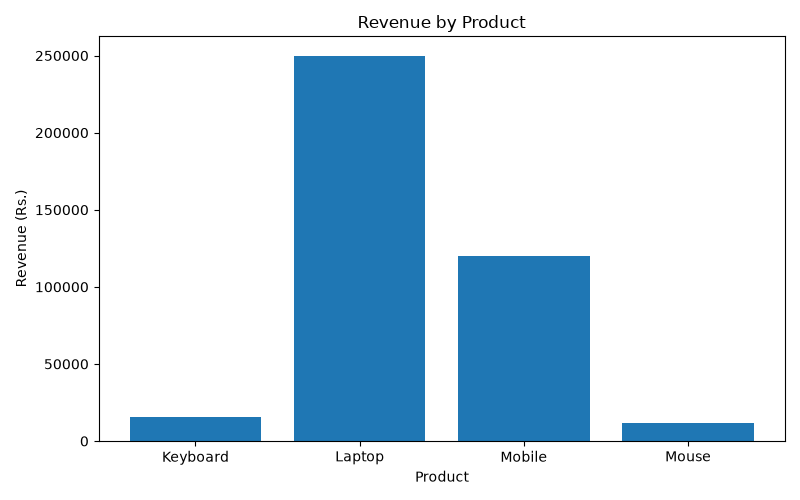
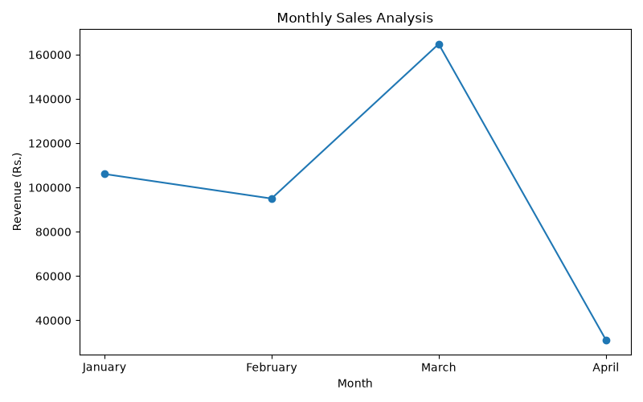
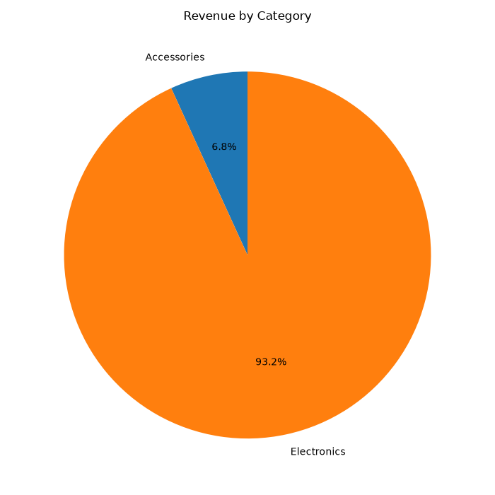

# Sales Data Analysis using Python

## Project Overview

This project analyses sales data using Python. It helps understand company sales performance, product revenue, monthly sales and regional performance.

The project uses Python libraries to clean, analyse and visualize sales information.

## Technologies Used

- Python
- Pandas
- NumPy
- Matplotlib

## Project Structure

```text
python-sales-data-analysis/
│
├── dataset/
│   └── sales.csv
│
├── notebooks/
│
├── images/
│   ├── revenue_by_product.png
│   ├── monthly_sales.png
│   └── category_sales.png
│
├── main.py
├── README.md
└── requirements.txt
```

## Features

1. Read sales data from a CSV file.
2. Check and clean missing values.
3. Identify duplicate records.
4. Calculate total sales revenue.
5. Find the best-selling product.
6. Analyse sales by region and month.
7. Create charts to visualize sales performance.

## Installation

Install the required libraries:

```bash
pip install -r requirements.txt
```

## How to Run

```bash
python main.py
```

## Visualizations

### Revenue by Product



### Monthly Sales



### Revenue by Category



## Learning Outcomes

- Learned how to read CSV files using Pandas.
- Practised data cleaning and filtering.
- Learned grouping and aggregation.
- Performed numerical calculations using NumPy.
- Created graphs using Matplotlib.